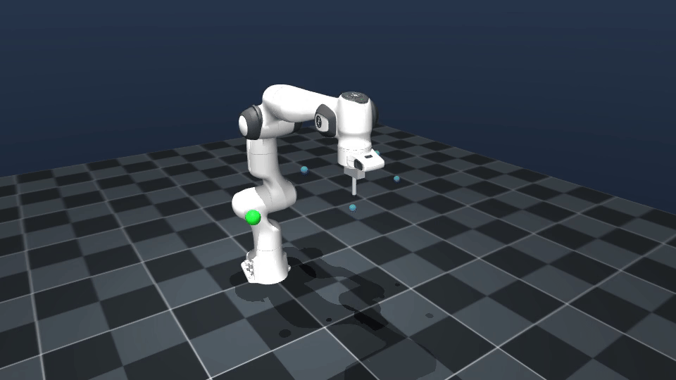
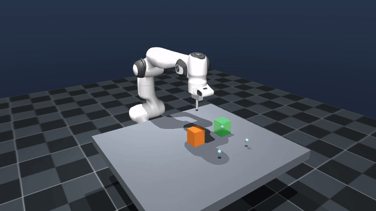
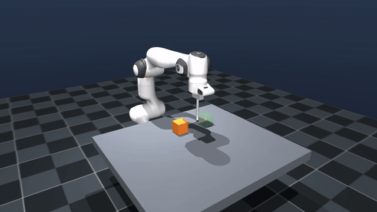
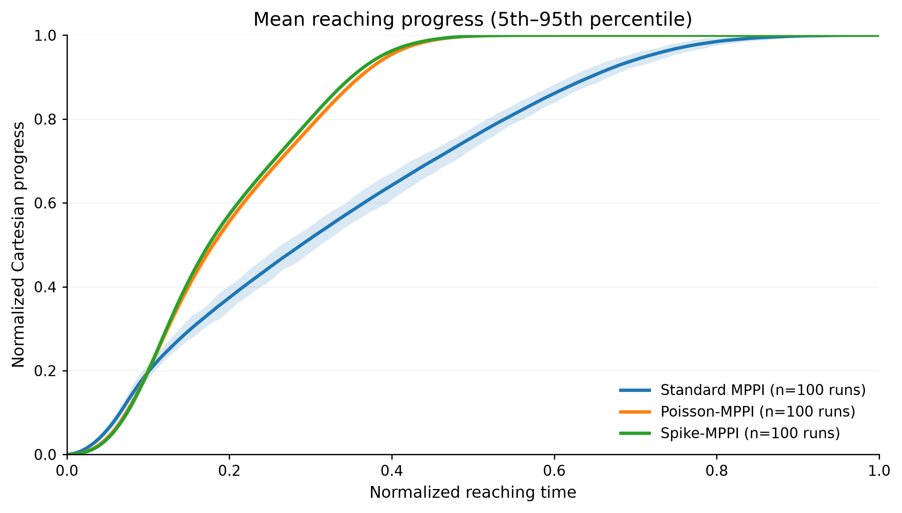
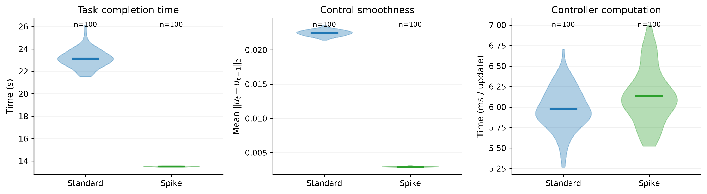

# Spike-MPPI for Franka Manipulation

This project studies **Franka Manipulation with Model Predictive Path Integral control (MPPI)** in MuJoCo.

The main novelty of this repository is **Spike-MPPI**, a motoneuron-inspired MPPI sampling method. Instead of directly sampling Gaussian actuator perturbations, Spike-MPPI generates perturbations through stochastic common drive, ordered motor-unit recruitment, discharge dynamics, and heterogeneous causal twitch responses.

Paper is available at: https://arxiv.org/abs/2609.28325

Detailed code and install for a locomotion task and Ant robot is available at: https://github.com/fleurssauvages/spikeMPPI

## Demo

<h3 align="center">Franka Reaching</h3>

<table align="center" width="100%">
  <tr>
    <th width="50%">Spike-MPPI (32 rollouts)</th>
    <th width="50%">Standard MPPI (32 rollouts)</th>
  </tr>
  <tr>
    <td align="center">
      
    </td>
    <td align="center">
      
    </td>
  </tr>
</table>

<br>

<h3 align="center">Franka Pushing</h3>

<table align="center" width="100%">
  <tr>
    <th width="50%">Spike-MPPI (32 rollouts)</th>
    <th width="50%">Standard MPPI (32 rollouts)</th>
  </tr>
  <tr>
    <td align="center">
      
    </td>
    <td align="center">
      
    </td>
  </tr>
</table>

## Results on 100 reaching runs

<h3 align="center">Normalized Reaching Progress</h3>

<p align="center">
  
</p>

<h3 align="center">Performances</h3>

<p align="center">
  
</p>


## Install

Requires Python 3.10+, MuJoCo 3.3+, and a C++17 compiler for the optional native rollout extension.

```bash
git clone https://github.com/fleurssauvages/Franka_MPPI.git
cd Franka_MPPI
python3 -m venv .venv
source .venv/bin/activate
python -m pip install -r requirements.txt
python manipulation/setup_native.py build_ext --inplace
```

## Run

```bash
python -m manipulation.franka_reaching.run --sampling spike
```

Use `--sampling standard` or `--sampling poisson` for comparison.
